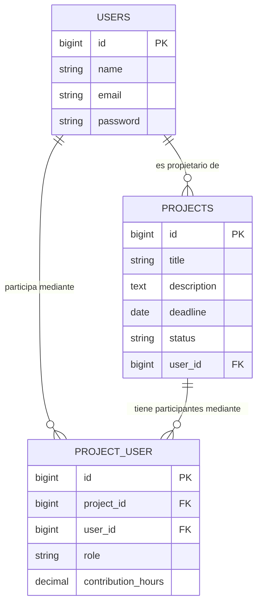

# Gestor de proyectos colaborativos

Aplicación web desarrollada con **Laravel 13** para crear proyectos y organizar el trabajo entre varios usuarios. Cada proyecto tiene un propietario, que puede añadir a otros usuarios registrados como participantes, asignarles un **rol** y anotar sus **horas de contribución**.

Es una aplicación **SSR (Server-Side Rendering)**: las vistas principales se generan en el servidor mediante Blade. Se utiliza Alpine.js para algunas interacciones de la interfaz.

Práctica final del tema 3 (Aplicaciones SSR con Laravel) de Desarrollo Web en Entorno Servidor, 2.º DAW.

---

## Índice

1. [Instalación y ejecución](#1-instalación-y-ejecución)
2. [Usuarios de prueba](#2-usuarios-de-prueba)
3. [Funcionalidades](#3-funcionalidades)
4. [Tecnologías utilizadas](#4-tecnologías-utilizadas)
5. [Base de datos](#5-base-de-datos)
6. [Modelos y relaciones Eloquent](#6-modelos-y-relaciones-eloquent)
7. [Rutas](#7-rutas)
8. [Controladores](#8-controladores)
9. [Autenticación y autorización](#9-autenticación-y-autorización)
10. [Validación](#10-validación)
11. [Vistas y componentes Blade](#11-vistas-y-componentes-blade)
12. [Seeders y datos de prueba](#12-seeders-y-datos-de-prueba)
13. [Estructura del proyecto](#13-estructura-del-proyecto)
14. [Decisiones de diseño](#14-decisiones-de-diseño)
15. [Instalación desde cero](#15-instalación-desde-cero)

---

## 1. Instalación y ejecución

Con el entorno ya preparado (dependencias instaladas, archivo `.env` configurado y recursos CSS compilados), basta con ejecutar desde la raíz del proyecto:

```bash
./vendor/bin/sail up -d
./vendor/bin/sail artisan migrate
```

Después, abrir en el navegador: **http://localhost**

### Cargar los datos de prueba

El comando `migrate` solamente crea las tablas. Para cargar los usuarios, proyectos y participantes de ejemplo:

```bash
./vendor/bin/sail artisan db:seed
```

El seeder utiliza `updateOrCreate()` y `sync()`, por lo que puede ejecutarse de nuevo sin duplicar los usuarios, proyectos ni participantes de ejemplo.

Para reiniciar completamente la base de datos y volver a crear las tablas junto con los datos de prueba:

```bash
./vendor/bin/sail artisan migrate:fresh --seed
```

**Importante:** `migrate:fresh` elimina todas las tablas y sus datos antes de crearlas de nuevo.

### Detener la aplicación

```bash
./vendor/bin/sail down
```

---

## 2. Usuarios de prueba

Todos los usuarios tienen la misma contraseña: `password`.

| Usuario | Correo | Contraseña |
|---|---|---|
| Ana | ana@example.com | password |
| Carlos | carlos@example.com | password |
| Laura | laura@example.com | password |
| Diego | diego@example.com | password |

### ¿Con quién entrar para ver qué?

| Usuario | Qué permite comprobar |
|---|---|
| Ana | Tiene proyectos propios, uno en progreso y otro pendiente con la fecha vencida. También participa en otros proyectos. |
| Carlos | Tiene un proyecto sin descripción y sin participantes. También participa en proyectos de otros usuarios. |
| Laura | Es propietaria de un proyecto finalizado y participa en otros proyectos. |
| Diego | No tiene proyectos ni participa en ninguno. Permite comprobar el estado vacío de la aplicación. |

También se puede crear un usuario nuevo desde la página de registro.

---

## 3. Funcionalidades

- **Landing page** para visitantes sin sesión, con enlaces para iniciar sesión o registrarse.
- **Autenticación** (registro, login, logout y perfil) mediante Laravel Breeze.
- **Panel de control** con estadísticas de proyectos creados, proyectos en los que participa, horas aportadas, proyectos recientes y próximos vencimientos.
- **CRUD de proyectos**: listar, ver detalle, crear, editar y eliminar. Cada proyecto tiene título, descripción, fecha límite y estado (`pendiente`, `en progreso` o `finalizado`).
- **Listado dividido en dos bloques**: proyectos creados por el usuario y proyectos en los que participa, mostrando su rol.
- **Gestión de participantes** (solo el propietario), desde la vista de detalle:
  - Añadir usuarios registrados con un rol (`Desarrollador`, `Diseñador` o `Tester`) y sus horas iniciales de contribución.
  - Modificar el rol y las horas de contribución.
  - Quitar participantes del proyecto.
- **Autorización**: solo el propietario puede editar o eliminar su proyecto y gestionar sus participantes.
- **Mensajes de confirmación y error** para informar del resultado de las operaciones.
- **Diseño responsive** con Tailwind CSS, adaptado a móvil y escritorio.

---

## 4. Tecnologías utilizadas

| Tecnología | Uso |
|---|---|
| Laravel 13 | Framework PHP y arquitectura MVC |
| PHP 8.5 | Lenguaje del servidor |
| MySQL 8.4 | Base de datos |
| Eloquent ORM | Acceso a datos y relaciones |
| Laravel Breeze (Blade) | Autenticación |
| Blade | Motor de plantillas y componentes |
| Alpine.js | Interacciones puntuales en la interfaz |
| Tailwind CSS + Vite | Estilos y compilación de recursos |
| Docker + Laravel Sail | Entorno de desarrollo en contenedores |

---

## 5. Base de datos

### Diagrama entidad-relación



### Tablas

**`users`**: tabla creada por Laravel y utilizada por Breeze para la autenticación.

**`projects`**

| Columna | Tipo | Notas |
|---|---|---|
| `id` | bigint | Clave primaria |
| `title` | string | Obligatorio |
| `description` | text | Opcional (`nullable`) |
| `deadline` | date | Fecha límite obligatoria |
| `status` | string | Por defecto `pendiente` |
| `user_id` | foreignId | Propietario. Referencia a `users.id` con `ON DELETE CASCADE` |
| `created_at`, `updated_at` | timestamps | Fechas de creación y actualización |

**`project_user`** (tabla intermedia de la relación N:N)

| Columna | Tipo | Notas |
|---|---|---|
| `id` | bigint | Clave primaria |
| `project_id` | foreignId | Referencia a `projects.id` con `ON DELETE CASCADE` |
| `user_id` | foreignId | Referencia a `users.id` con `ON DELETE CASCADE` |
| `role` | string | Rol del usuario en el proyecto |
| `contribution_hours` | decimal(8, 2) | Horas de contribución, por defecto `0` |
| `created_at`, `updated_at` | timestamps | Fechas de creación y actualización |

Tiene una restricción **`unique(project_id, user_id)`**: un mismo usuario no puede añadirse dos veces al mismo proyecto.

### Relaciones

- **1:N (propietario):** un usuario puede ser propietario de muchos proyectos y cada proyecto tiene un único propietario. Se establece mediante `projects.user_id`.
- **N:N (participantes):** un usuario puede participar en muchos proyectos y un proyecto puede tener muchos participantes. Se utiliza la tabla intermedia `project_user`, que además almacena el rol y las horas de contribución.

### Borrados en cascada

- Si se elimina un **proyecto**, se borran automáticamente sus filas de `project_user`.
- Si se elimina un **usuario**, se borran sus proyectos y sus participaciones.

---

## 6. Modelos y relaciones Eloquent

### `App\Models\Project`

El modelo `Project` contiene los campos que se pueden asignar mediante asignación masiva, las constantes de roles y estados y las relaciones con usuarios.

- `owner()`: relación `belongsTo(User::class, 'user_id')`. Devuelve el usuario propietario del proyecto.
- `members()`: relación `belongsToMany(User::class)`. Devuelve los participantes a través de `project_user`, incluyendo `role`, `contribution_hours` y las marcas de tiempo.
- `isOverdue()`: comprueba si la fecha límite ya ha pasado y el proyecto no está finalizado.
- `casts()`: convierte `deadline` en un objeto de fecha para poder utilizar métodos como `format()`.

Las constantes `ROLES` y `STATUSES` centralizan los valores permitidos para roles y estados.

### `App\Models\User`

El modelo `User` contiene dos relaciones diferentes:

- `ownedProjects()`: relación **`hasMany(Project::class)`**. Devuelve los proyectos cuyo propietario es ese usuario. Utiliza la columna `user_id` de la tabla `projects`, **sin utilizar una tabla intermedia**.
- `projects()`: relación **`belongsToMany(Project::class)`**. Devuelve los proyectos en los que participa el usuario mediante la tabla intermedia `project_user`. Incluye los campos `role`, `contribution_hours` y las marcas de tiempo con `withPivot()` y `withTimestamps()`.

Las relaciones se pueden utilizar con paréntesis para seguir construyendo consultas, por ejemplo `->count()`, o para obtener directamente los datos.

---

## 7. Rutas

Las rutas de la aplicación, salvo la landing y las de autenticación, están protegidas mediante el middleware `auth`.

| Verbo | URL | Nombre | Controlador | Descripción |
|---|---|---|---|---|
| GET | `/` | — | Closure | Landing page |
| GET | `/dashboard` | `dashboard` | `DashboardController` | Panel de control |
| GET | `/projects` | `projects.index` | `ProjectController@index` | Listado de proyectos |
| GET | `/projects/create` | `projects.create` | `ProjectController@create` | Formulario de creación |
| POST | `/projects` | `projects.store` | `ProjectController@store` | Guardar proyecto |
| GET | `/projects/{project}` | `projects.show` | `ProjectController@show` | Detalle del proyecto |
| GET | `/projects/{project}/edit` | `projects.edit` | `ProjectController@edit` | Formulario de edición |
| PUT/PATCH | `/projects/{project}` | `projects.update` | `ProjectController@update` | Actualizar proyecto |
| DELETE | `/projects/{project}` | `projects.destroy` | `ProjectController@destroy` | Eliminar proyecto |
| POST | `/projects/{project}/members` | `projects.members.store` | `ProjectMemberController@store` | Añadir participante |
| PATCH | `/projects/{project}/members/{user}` | `projects.members.update` | `ProjectMemberController@update` | Modificar rol y horas |
| DELETE | `/projects/{project}/members/{user}` | `projects.members.destroy` | `ProjectMemberController@destroy` | Quitar participante |
| GET/PATCH/DELETE | `/profile` | `profile.*` | `ProfileController` | Perfil de usuario |

Las rutas de proyectos se registran mediante `Route::resource('projects', ProjectController::class)`. Las de autenticación las añade Breeze en `routes/auth.php`, incluido desde `routes/web.php`.

Se utiliza **route model binding**: en rutas como `/projects/{project}`, Laravel obtiene el modelo correspondiente y devuelve un 404 automáticamente si no existe.

Para consultar todas las rutas registradas:

```bash
./vendor/bin/sail artisan route:list
```

---

## 8. Controladores

### `ProjectController`

| Método | Qué hace |
|---|---|
| `index()` | Obtiene los proyectos propios y aquellos en los que participa el usuario y los envía a la vista. |
| `create()` | Muestra el formulario de creación. |
| `store()` | Valida los datos y crea el proyecto. El propietario se obtiene mediante `Auth::id()`, nunca del formulario. |
| `show()` | Muestra el detalle del proyecto, sus participantes y los usuarios disponibles para añadir. |
| `edit()` | Muestra el formulario de edición y comprueba que el usuario sea el propietario. |
| `update()` | Comprueba la autorización, valida los datos y actualiza el proyecto. |
| `destroy()` | Comprueba la autorización y elimina el proyecto. |

### `ProjectMemberController`

Gestiona los participantes de un proyecto. En sus tres métodos comprueba primero que quien realiza la petición sea el propietario.

| Método | Qué hace |
|---|---|
| `store()` | Valida los datos, comprueba que el usuario no sea el propietario ni participe ya y lo añade con `attach()`. |
| `update()` | Comprueba que el usuario participa en el proyecto y modifica su rol y sus horas con `updateExistingPivot()`. |
| `destroy()` | Comprueba que el usuario participa en el proyecto y lo elimina con `detach()`. |

Los resultados de las operaciones se comunican mediante mensajes flash de sesión (`success` y `error`).

### `DashboardController`

Es un controlador de una sola acción (*invokable*), con el método `__invoke()`. Calcula los proyectos creados, los proyectos en los que participa el usuario, las horas aportadas, los proyectos recientes y los próximos vencimientos.

---

## 9. Autenticación y autorización

### Autenticación

La proporciona **Laravel Breeze** en su versión Blade: registro, inicio y cierre de sesión, recuperación de contraseña y gestión del perfil. Las contraseñas se almacenan mediante **hash**.

Las rutas privadas llevan el middleware `auth`. Si un usuario no ha iniciado sesión, se le redirige al login.

### Autorización: `ProjectPolicy`

La regla de permisos se centraliza en `App\Policies\ProjectPolicy`:

- `update()`: permite modificar un proyecto únicamente a su propietario.
- `delete()`: permite eliminar un proyecto únicamente a su propietario.

Se aplica en dos niveles:

- **En el servidor:** los controladores utilizan `Gate::authorize()` para comprobar los permisos. Si el usuario no es el propietario, Laravel responde con un error 403.
- **En las vistas:** se utilizan `@can('update', $project)` y `@can('delete', $project)` para mostrar los botones y formularios de gestión únicamente al propietario.

Cualquier usuario con sesión iniciada puede **consultar el detalle de un proyecto**, pero solo el propietario puede modificarlo, eliminarlo o gestionar sus participantes.

---

## 10. Validación

Las validaciones se realizan en el servidor mediante `$request->validate()`. Para guardar se utilizan los datos validados.

**Proyecto** (`store` y `update`):

| Campo | Reglas |
|---|---|
| `title` | `required`, `max:255` |
| `description` | `nullable` |
| `deadline` | `required`, `date` |
| `status` | `required`, `Rule::in(Project::STATUSES)` |

**Participante** (`ProjectMemberController`):

| Campo | Reglas |
|---|---|
| `user_id` (al añadir) | `required`, `exists:users,id` |
| `role` | `required`, `Rule::in(Project::ROLES)` |
| `contribution_hours` (al añadir) | `nullable`, `numeric`, `min:0`, `max:10000`. Es opcional. |
| `contribution_hours` (al modificar) | `required`, `numeric`, `min:0`, `max:10000`. Es obligatorio. |

Además, el controlador comprueba que:

- El propietario no se añada como participante.
- No se añada dos veces al mismo usuario.
- Solo se modifique o elimine a usuarios que realmente participan en el proyecto.

En los formularios se muestran los errores de validación y se conservan los datos introducidos mediante `old()`.

---

## 11. Vistas y componentes Blade

Las vistas del área autenticada utilizan el layout de Breeze mediante el componente `<x-app-layout>`. La excepción es `welcome.blade.php`, que es una página independiente con su propia estructura HTML y funciona como landing page.

### Vistas

| Vista | Qué muestra |
|---|---|
| `welcome.blade.php` | Landing page con enlaces de acceso y presentación de la aplicación. |
| `dashboard.blade.php` | Estadísticas, proyectos recientes y próximos vencimientos. |
| `projects/index.blade.php` | Proyectos propios y proyectos en los que participa el usuario, organizados en tarjetas. |
| `projects/show.blade.php` | Datos del proyecto, participantes y opciones de gestión según los permisos. |
| `projects/create.blade.php` | Formulario de creación. |
| `projects/edit.blade.php` | Formulario de edición con los valores actuales. |

### Componentes propios (`resources/views/components/`)

| Componente | Uso | Qué hace |
|---|---|---|
| `<x-card>` | Tarjetas reutilizables | Tarjeta blanca con sombra y esquinas redondeadas. |
| `<x-status-badge>` | `<x-status-badge :status="$project->status" />` | Etiqueta de color según el estado del proyecto. |
| `<x-project-card>` | `<x-project-card :project="$p" :role="$rol" />` | Tarjeta de proyecto para los listados. El rol es opcional. |
| `<x-members-table>` | `<x-members-table :project="$project" />` | Tabla de participantes con opciones de gestión para el propietario. |

### Otros detalles

- **Seguridad en formularios:** se utiliza `@csrf` y `@method()` para simular los métodos HTTP necesarios.
- **Protección frente a XSS:** se utiliza `{{ }}` para escapar la salida.
- **Confirmaciones:** se utiliza `confirm()` antes de eliminar proyectos o participantes.
- **Diseño responsive:** rejillas adaptables y tablas con desplazamiento horizontal en pantallas pequeñas.
- **Navegación:** menú en español con enlaces al panel y a los proyectos, tanto en escritorio como en móvil.
- **Notificaciones:** los mensajes de éxito y error se muestran desde el layout principal.

---

## 12. Seeders y datos de prueba

`ProjectSeeder`, llamado desde `DatabaseSeeder`, crea cuatro usuarios de prueba y cinco proyectos.

Las fechas se calculan de forma relativa utilizando `today()`, por lo que se actualizan según el día en que se ejecuta el seeder.

| Proyecto | Propietario | Fecha límite | Estado | Participantes |
|---|---|---|---|---|
| Aplicación web | Ana | Dentro de 15 días | en progreso | Carlos (Tester, 10 h), Laura (Desarrollador, 20 h) |
| Tienda online | Carlos | Dentro de 30 días | pendiente | Ana (Diseñador, 15 h) |
| Gestión de tareas | Laura | Hace 10 días | finalizado | Ana (Tester, 8 h) |
| Rediseño de plataforma | Ana | Ayer | pendiente | Carlos (Diseñador, 12,5 h), Laura (Tester, 6 h) |
| Documentación interna | Carlos | Dentro de 45 días | pendiente | Sin participantes |

El proyecto «Documentación interna» no tiene descripción y tampoco tiene participantes.

Diego se crea como usuario de prueba, pero no tiene proyectos ni participaciones.

Estos datos permiten comprobar las relaciones entre usuarios y proyectos, los roles, las horas de contribución, los distintos estados y los proyectos vencidos.

---

## 13. Estructura del proyecto

Archivos principales escritos o modificados para la práctica:

```text
app/
├── Http/Controllers/
│   ├── DashboardController.php
│   ├── ProjectController.php
│   └── ProjectMemberController.php
├── Models/
│   ├── Project.php
│   └── User.php
└── Policies/
    └── ProjectPolicy.php

database/
├── migrations/
│   ├── ..._create_projects_table.php
│   └── ..._create_project_user_table.php
└── seeders/
    ├── DatabaseSeeder.php
    └── ProjectSeeder.php

resources/views/
├── components/
│   ├── card.blade.php
│   ├── members-table.blade.php
│   ├── project-card.blade.php
│   └── status-badge.blade.php
├── layouts/
│   └── navigation.blade.php
├── projects/
│   ├── create.blade.php
│   ├── edit.blade.php
│   ├── index.blade.php
│   └── show.blade.php
├── dashboard.blade.php
└── welcome.blade.php

routes/
├── auth.php
└── web.php
```

---

## 14. Decisiones de diseño

- **Controlador independiente para los participantes:** `ProjectController` gestiona proyectos y `ProjectMemberController` gestiona sus participantes. Así cada controlador tiene una responsabilidad concreta.
- **Política de permisos centralizada:** la regla de que solo el propietario puede modificar o eliminar un proyecto se encuentra en `ProjectPolicy`.
- **El propietario no se guarda como participante:** se identifica mediante `projects.user_id`. Por eso, en el listado, un proyecto propio aparece en «Creados por mí» y no en «Participo».
- **Roles y estados con listas cerradas:** se utilizan constantes para evitar guardar valores inventados.
- **Componentes Blade reutilizables:** las tarjetas, etiquetas de estado y tabla de participantes se mantienen en componentes independientes.
- **Validaciones en el servidor:** las comprobaciones no dependen únicamente de los atributos HTML de los formularios.
- **Acceso al detalle:** cualquier usuario autenticado puede consultar un proyecto, pero solo su propietario puede gestionar sus datos y participantes.

---

## 15. Instalación desde cero

Esta sección recoge una guía de instalación para un entorno en el que todavía no estén preparadas las dependencias.


Requisitos: **Docker**, **WSL con Ubuntu** en Windows y **Git**.

### 1. Clonar el repositorio

```bash
git clone https://github.com/jgaragu1705/gestor-proyectos.git
cd gestor-proyectos
```

### 2. Crear el archivo de entorno

```bash
cp .env.example .env
```

### 3. Instalar las dependencias de PHP

La carpeta `vendor` no se incluye en el repositorio. La guía contempla utilizar un contenedor temporal de Composer:

```bash
docker run --rm \
    -u "$(id -u):$(id -g)" \
    -v "$(pwd):/var/www/html" \
    -w /var/www/html \
    laravelsail/php84-composer:latest \
    composer install --ignore-platform-reqs
```


### 4. Levantar los contenedores

```bash
./vendor/bin/sail up -d
```

### 5. Generar la clave de la aplicación

```bash
./vendor/bin/sail artisan key:generate
```

### 6. Crear las tablas y cargar los datos de prueba

```bash
./vendor/bin/sail artisan migrate --seed
```

### 7. Instalar y compilar los recursos de frontend

```bash
./vendor/bin/sail npm install
./vendor/bin/sail npm run build
```

Después, abrir **http://localhost**.

---

**Repositorio:** https://github.com/jgaragu1705/gestor-proyectos
