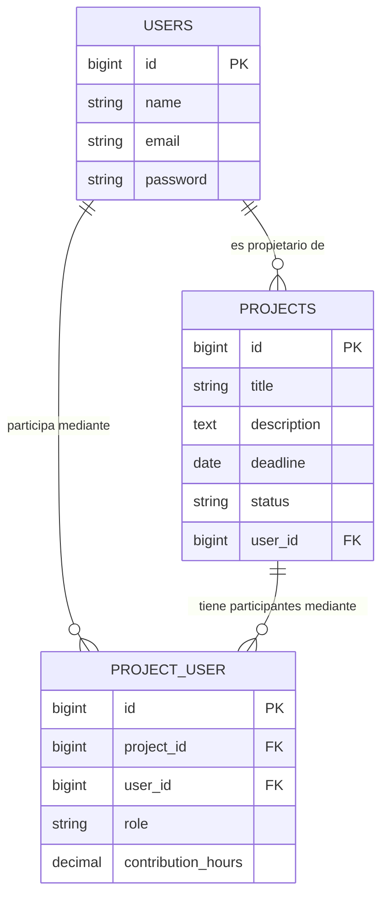

# Gestor de proyectos colaborativos

Aplicación web desarrollada con **Laravel 13** para crear proyectos y organizar el trabajo entre varios usuarios. Cada proyecto tiene un propietario, que puede añadir a otros usuarios registrados como participantes, asignarles un **rol** y anotar sus **horas de contribución**.

Es una aplicación **SSR (Server-Side Rendering)**: todas las vistas se generan en el servidor con Blade, sin framework de JavaScript en el cliente.

Práctica final del tema 3 (Aplicaciones SSR con Laravel) de Desarrollo Web en Entorno Servidor, 2º DAW.

---

## Índice

1. [Instalación y ejecución](#instalación-y-ejecución)
2. [Usuarios de prueba](#usuarios-de-prueba)
3. [Funcionalidades](#funcionalidades)
4. [Tecnologías utilizadas](#tecnologías-utilizadas)
5. [Base de datos](#base-de-datos)
6. [Modelos y relaciones Eloquent](#modelos-y-relaciones-eloquent)
7. [Rutas](#rutas)
8. [Controladores](#controladores)
9. [Autenticación y autorización](#autenticación-y-autorización)
10. [Validación](#validación)
11. [Vistas y componentes Blade](#vistas-y-componentes-blade)
12. [Seeders y datos de prueba](#seeders-y-datos-de-prueba)
13. [Estructura del proyecto](#estructura-del-proyecto)
14. [Decisiones de diseño](#decisiones-de-diseño)
15. [Instalación desde cero](#instalación-desde-cero-por-si-falta-algo)

---

## Instalación y ejecución

Con el entorno ya preparado (dependencias instaladas, archivo `.env` configurado y CSS compilado), basta con ejecutar desde la raíz del proyecto:

```bash
./vendor/bin/sail up -d
./vendor/bin/sail artisan migrate
```

Después, abrir en el navegador: **http://localhost**

### Cargar los datos de prueba

`migrate` solo crea las tablas. Para cargar los usuarios, proyectos y participantes de ejemplo:

```bash
./vendor/bin/sail artisan db:seed
```

Para **reiniciar** la base de datos y volver a cargar los datos de prueba (si se ejecuta `db:seed` dos veces seguidas falla, porque los correos son únicos):

```bash
./vendor/bin/sail artisan migrate:fresh --seed
```

### Detener la aplicación

```bash
./vendor/bin/sail down
```

---

## Usuarios de prueba

Todos tienen la misma contraseña: `password`.

| Usuario | Correo | Contraseña | Qué tiene |
|---|---|---|---|
| Ana | ana@gmail.com | password | Propietaria del proyecto *Aplicación web*. Participa en los otros dos. |
| Carlos | carlos@gmail.com | password | Propietario de *Tienda online*. Participa en *Aplicación web*. |
| Laura | laura@gmail.com | password | Propietaria de *Gestión de tareas*. Participa en *Aplicación web*. |

También se puede crear un usuario nuevo desde la página de registro.

---

## Funcionalidades

- **Landing page** para visitantes sin sesión, con enlaces para iniciar sesión o registrarse.
- **Autenticación** (registro, login, logout y perfil) con Laravel Breeze.
- **Panel de control** con el número de proyectos creados y de proyectos en los que participa el usuario.
- **CRUD de proyectos**: listar, ver detalle, crear, editar y eliminar. Cada proyecto tiene título, descripción, fecha límite y estado (*pendiente*, *en progreso* o *finalizado*).
- **Listado dividido en dos bloques**: proyectos creados por el usuario y proyectos en los que participa, con su rol.
- **Gestión de participantes** (solo el propietario), desde la vista de detalle del proyecto:
  - Añadir a un usuario registrado con un rol (*Desarrollador*, *Diseñador* o *Tester*) y unas horas iniciales.
  - Modificar el rol y las horas de contribución de un participante.
  - Quitar a un participante del proyecto.
- **Autorización**: solo el propietario puede editar o borrar su proyecto y gestionar a sus participantes.
- **Mensajes de confirmación y de error** (por ejemplo, al intentar añadir a alguien que ya participa).
- **Diseño responsive** con Tailwind CSS, que se adapta a móvil y escritorio.

---

## Tecnologías utilizadas

| Tecnología | Uso |
|---|---|
| Laravel 13 | Framework PHP (arquitectura MVC) |
| PHP 8.5 | Lenguaje del servidor |
| MySQL 8.4 | Base de datos |
| Eloquent ORM | Acceso a datos y relaciones |
| Laravel Breeze (Blade) | Autenticación |
| Blade | Motor de plantillas y componentes |
| Tailwind CSS + Vite | Estilos y compilación de recursos |
| Docker + Laravel Sail | Entorno de desarrollo en contenedores |

---

## Base de datos

### Diagrama entidad-relación



### Tablas

**`users`**: la crea Laravel y la usa Breeze para la autenticación.

**`projects`**

| Columna | Tipo | Notas |
|---|---|---|
| `id` | bigint | Clave primaria |
| `title` | string | Obligatorio |
| `description` | text | Opcional (`nullable`) |
| `deadline` | date | Fecha límite, obligatoria |
| `status` | string | Por defecto `pendiente` |
| `user_id` | foreignId | Propietario. Referencia a `users.id` con `ON DELETE CASCADE` |
| `created_at`, `updated_at` | timestamps | |

**`project_user`** (tabla pivote de la relación N:N)

| Columna | Tipo | Notas |
|---|---|---|
| `id` | bigint | Clave primaria |
| `project_id` | foreignId | Referencia a `projects.id` con `ON DELETE CASCADE` |
| `user_id` | foreignId | Referencia a `users.id` con `ON DELETE CASCADE` |
| `role` | string | Rol del usuario en el proyecto |
| `contribution_hours` | decimal(8, 2) | Horas trabajadas. Por defecto `0` |
| `created_at`, `updated_at` | timestamps | |

Tiene una restricción **`unique(project_id, user_id)`**: el mismo usuario no puede añadirse dos veces al mismo proyecto.

### Relaciones

- **1:N (propietario)**: un usuario es propietario de muchos proyectos; cada proyecto tiene un único propietario (`projects.user_id`).
- **N:N (participantes)**: un usuario participa en muchos proyectos y un proyecto tiene muchos participantes, a través de `project_user`, que además guarda el `role` y las `contribution_hours`.

El nombre `project_user` sigue la convención de Laravel (nombres de los dos modelos en singular, en orden alfabético y separados por guion bajo), así que Eloquent lo detecta sin configuración extra.

### Borrados en cascada

- Si se elimina un **proyecto**, se borran automáticamente sus filas de `project_user`.
- Si se elimina un **usuario**, se borran sus proyectos y sus participaciones.

### Migraciones

| Migración | Qué crea |
|---|---|
| `..._create_users_table` | `users` (y las tablas de sesiones y de reseteo de contraseña) |
| `..._create_cache_table` | Tablas de caché |
| `..._create_jobs_table` | Tablas de colas |
| `2026_11_05_181540_create_projects_table` | `projects` |
| `2026_11_05_182339_create_project_user_table` | `project_user` |

Las sesiones se guardan en la base de datos (`SESSION_DRIVER=database`), por eso hay que ejecutar `migrate` antes de abrir la aplicación.

---

## Modelos y relaciones Eloquent

### `App\Models\Project`

```php
public const ROLES = ['Desarrollador', 'Diseñador', 'Tester'];

protected $fillable = ['title', 'description', 'deadline', 'status', 'user_id'];

// 'deadline' se convierte en objeto de fecha (permite ->format('d/m/Y'))

public function owner()   // belongsTo(User::class, 'user_id')
public function members() // belongsToMany(User::class)->withPivot('role', 'contribution_hours')->withTimestamps()
```

- `ROLES` guarda la lista de roles **una sola vez**. La usan la validación y los desplegables de las vistas.
- `members()` devuelve cada usuario con un objeto `pivot` que permite leer `->pivot->role` y `->pivot->contribution_hours`.

### `App\Models\User`

```php
public function ownedProjects() // hasMany(Project::class)             -> proyectos que ha creado
public function projects()      // belongsToMany(Project::class)
                                //   ->withPivot('role', 'contribution_hours')->withTimestamps()
                                //                                       -> proyectos en los que participa
```

Se usan con paréntesis cuando se quiere seguir construyendo la consulta (por ejemplo `->count()`, que hace un `SELECT COUNT(*)` en MySQL) y sin paréntesis para obtener los datos.

---

## Rutas

Todas las rutas de la aplicación, salvo la landing y las de autenticación, están protegidas con el middleware `auth`.

| Verbo | URL | Nombre | Controlador | Descripción |
|---|---|---|---|---|
| GET | `/` | — | (closure) | Landing page |
| GET | `/dashboard` | `dashboard` | `DashboardController` | Panel de control |
| GET | `/projects` | `projects.index` | `ProjectController@index` | Listado de proyectos |
| GET | `/projects/create` | `projects.create` | `ProjectController@create` | Formulario de creación |
| POST | `/projects` | `projects.store` | `ProjectController@store` | Guardar proyecto |
| GET | `/projects/{project}` | `projects.show` | `ProjectController@show` | Detalle del proyecto |
| GET | `/projects/{project}/edit` | `projects.edit` | `ProjectController@edit` | Formulario de edición |
| PUT/PATCH | `/projects/{project}` | `projects.update` | `ProjectController@update` | Actualizar proyecto |
| DELETE | `/projects/{project}` | `projects.destroy` | `ProjectController@destroy` | Eliminar proyecto |
| POST | `/projects/{project}/members` | `projects.members.store` | `ProjectMemberController@store` | Añadir participante |
| PATCH | `/projects/{project}/members/{user}` | `projects.members.update` | `ProjectMemberController@update` | Modificar rol y horas |
| DELETE | `/projects/{project}/members/{user}` | `projects.members.destroy` | `ProjectMemberController@destroy` | Quitar participante |
| GET/PATCH/DELETE | `/profile` | `profile.*` | `ProfileController` | Perfil (Breeze) |

Las rutas de proyectos se registran con `Route::resource('projects', ProjectController::class)`. Las de login, registro y recuperación de contraseña las añade Breeze en `routes/auth.php`, que se incluye al final de `routes/web.php`.

Se usa **route model binding**: en rutas como `/projects/{project}` Laravel recibe el modelo ya cargado en el método del controlador y devuelve un 404 automático si no existe.

Para ver todas las rutas registradas:

```bash
./vendor/bin/sail artisan route:list
```

---

## Controladores

### `ProjectController` (resource)

| Método | Qué hace |
|---|---|
| `index()` | Obtiene los proyectos creados por el usuario (`ownedProjects`) y aquellos en los que participa (`projects`) y los pasa a la vista. |
| `create()` | Muestra el formulario de creación. |
| `store()` | Valida los datos y crea el proyecto. El propietario se toma de `Auth::id()`, **nunca del formulario**. |
| `show()` | Muestra el detalle con sus participantes y calcula `$usuariosDisponibles` (usuarios que no son ni el propietario ni miembros) para el formulario de añadir. |
| `edit()` | Muestra el formulario de edición. Comprueba que el usuario sea el propietario. |
| `update()` | Comprueba la autorización, valida y actualiza. |
| `destroy()` | Comprueba la autorización y elimina el proyecto. |

### `ProjectMemberController`

Gestiona los participantes de un proyecto. En los tres métodos, lo primero es comprobar que quien hace la petición es el propietario.

| Método | Qué hace |
|---|---|
| `store()` | Valida los datos, comprueba que el usuario no sea el propietario ni ya participe y lo añade con `attach()`, guardando el rol y las horas en la tabla pivote. |
| `update()` | Comprueba que el usuario participa en el proyecto y modifica su rol y sus horas con `updateExistingPivot()`. |
| `destroy()` | Comprueba que el usuario participa en el proyecto y lo quita con `detach()`. |

Los resultados se comunican al usuario con mensajes *flash* de sesión (`success` y `error`).

### `DashboardController`

Controlador de una sola acción (*invokable*, método `__invoke()`). Calcula cuántos proyectos ha creado el usuario y en cuántos participa, con `count()` sobre las relaciones.

---

## Autenticación y autorización

### Autenticación

La proporciona **Laravel Breeze** (versión Blade): registro, login, logout, recuperación de contraseña y perfil. Las contraseñas se guardan cifradas (*hash*).

Todas las rutas de la aplicación, salvo la landing y las de autenticación, llevan el middleware `auth`. Quien no ha iniciado sesión es redirigido a `/login`.

### Autorización: `ProjectPolicy`

La regla de permisos está en **un solo sitio**, la policy `App\Policies\ProjectPolicy`:

```php
public function update(User $user, Project $project): bool
{
    return $project->user_id == $user->id;   // solo el propietario
}

public function delete(User $user, Project $project): bool
{
    return $project->user_id == $user->id;   // solo el propietario
}
```

Se aplica en dos niveles:

- **En el servidor** (la seguridad real): los controladores llaman a `Gate::authorize('update', $project)` (o `'delete'`) en la primera línea de `edit`, `update`, `destroy` y de los tres métodos de `ProjectMemberController`. Si el usuario no es el propietario, Laravel responde con un **403**, aunque la petición se haya construido a mano sin pasar por el formulario.
- **En las vistas** (comodidad del usuario): con `@can('update', $project)` y `@can('delete', $project)` solo se muestran los botones y formularios de gestión al propietario.

Cualquier usuario con sesión iniciada puede **ver** el detalle de un proyecto, pero solo el propietario puede modificarlo.

---

## Validación

Todas las validaciones se hacen en el servidor con `$request->validate()`, y solo se usan los datos validados para guardar.

**Proyecto** (`store` y `update`):

| Campo | Reglas |
|---|---|
| `title` | `required|max:255` |
| `description` | `nullable` |
| `deadline` | `required|date` |
| `status` | `required|in:pendiente,en progreso,finalizado` |

**Participante** (`ProjectMemberController`):

| Campo | Reglas |
|---|---|
| `user_id` (al añadir) | `required|exists:users,id` |
| `role` | `required` y `Rule::in(Project::ROLES)` |
| `contribution_hours` | `nullable|numeric|min:0` al añadir; `required|numeric|min:0` al modificar |

Además de las reglas, el controlador comprueba que:
- el propietario no se añada como participante,
- no se añada dos veces al mismo usuario,
- solo se modifique o elimine a usuarios que realmente participan en el proyecto.

En los formularios, los errores se muestran con `@error` y se conservan los datos escritos con `old()`.

---

## Vistas y componentes Blade

Todas las vistas usan el layout de Breeze mediante el componente `<x-app-layout>`.

### Vistas

| Vista | Qué muestra |
|---|---|
| `welcome.blade.php` | Landing page: cabecera con enlaces de acceso, sección principal y tres tarjetas con las ventajas. Cambia según haya o no sesión (`@guest` / `@auth`). |
| `dashboard.blade.php` | Saludo y dos contadores (proyectos creados y proyectos en los que participa). |
| `projects/index.blade.php` | Proyectos en dos bloques, en tarjetas dentro de una rejilla responsive. |
| `projects/show.blade.php` | Datos del proyecto, tabla de participantes, formulario de añadir participante y botones de editar y eliminar (solo para el propietario). |
| `projects/create.blade.php` | Formulario de creación. |
| `projects/edit.blade.php` | Formulario de edición, con los valores actuales. |

### Componentes propios (`resources/views/components/`)

| Componente | Uso | Qué hace |
|---|---|---|
| `<x-card>` | `<x-card class="mb-6">...</x-card>` | Tarjeta blanca con sombra y esquinas redondeadas. Acepta clases extra. |
| `<x-status-badge>` | `<x-status-badge :status="$project->status" />` | Etiqueta de color según el estado: amarillo (pendiente), azul (en progreso), verde (finalizado). |
| `<x-project-card>` | `<x-project-card :project="$p" :role="$rol" />` | Tarjeta de un proyecto del listado. El rol es opcional. |
| `<x-members-table>` | `<x-members-table :project="$project" />` | Tabla de participantes con los formularios para modificar o quitar, visibles solo para el propietario. |

### Otros detalles

- **Seguridad en las vistas**: `@csrf` en todos los formularios, `@method('PUT' | 'PATCH' | 'DELETE')` para simular esos verbos, y `{{ }}` para escapar la salida y evitar XSS.
- **Confirmación** (`confirm()`) antes de eliminar un proyecto o a un participante.
- **Diseño responsive**: rejillas con `grid-cols-1 md:grid-cols-2 lg:grid-cols-3` y tablas con scroll horizontal en pantallas pequeñas.
- **Menú de navegación** en español, con enlaces a *Panel* y *Proyectos*, tanto en escritorio como en el menú móvil.

---

## Seeders y datos de prueba

`ProjectSeeder` (llamado desde `DatabaseSeeder`) crea:

| Proyecto | Propietario | Fecha límite | Estado | Participantes |
|---|---|---|---|---|
| Aplicación web | Ana | 15/12/2026 | en progreso | Carlos (Tester, 10 h), Laura (Desarrollador, 20 h) |
| Tienda online | Carlos | 20/01/2027 | pendiente | Ana (Diseñador, 15 h) |
| Gestión de tareas | Laura | 10/02/2027 | finalizado | Ana (Tester, 8 h) |

Así se puede probar desde el primer momento la relación N:N con los datos extra de la tabla pivote.

---

## Estructura del proyecto

Archivos principales (solo los escritos o modificados para la práctica):

```
app/
├── Http/Controllers/
│   ├── DashboardController.php
│   ├── ProjectController.php
│   └── ProjectMemberController.php
├── Models/
│   ├── Project.php
│   └── User.php
└── Policies/
    └── ProjectPolicy.php

database/
├── migrations/
│   ├── ..._create_projects_table.php
│   └── ..._create_project_user_table.php
└── seeders/
    ├── DatabaseSeeder.php
    └── ProjectSeeder.php

resources/views/
├── components/
│   ├── card.blade.php
│   ├── members-table.blade.php
│   ├── project-card.blade.php
│   └── status-badge.blade.php
├── layouts/
│   └── navigation.blade.php
├── projects/
│   ├── create.blade.php
│   ├── edit.blade.php
│   ├── index.blade.php
│   └── show.blade.php
├── dashboard.blade.php
└── welcome.blade.php

routes/
├── auth.php     (Breeze)
└── web.php
```

---

## Decisiones de diseño

- **Un controlador aparte para los participantes.** `ProjectController` solo gestiona proyectos y `ProjectMemberController` gestiona a sus miembros. Así cada clase tiene una única responsabilidad.
- **Política de permisos en un solo lugar.** La regla "solo el propietario" vive en `ProjectPolicy` y se reutiliza en controladores y vistas.
- **El propietario no se guarda como participante.** Se identifica por `projects.user_id`. Por eso, en el listado, un proyecto propio aparece en *Creados por mí* y no en *Participo*.
- **El rol y el estado se validan contra listas cerradas.** Aunque se manipule el formulario, no se puede guardar un valor inventado.
- **Los roles se definen una sola vez** en la constante `Project::ROLES`.
- **Componentes Blade** para todo lo que se repite (tarjeta, badge, tarjeta de proyecto y tabla de participantes), de modo que cambiar su aspecto implica tocar un solo archivo.
- **Todas las validaciones en el servidor**, además de las comprobaciones básicas del HTML.
- **Textos de la interfaz en español.** Los mensajes de validación propios de Laravel se muestran en el idioma configurado en `APP_LOCALE`.

---

## Instalación desde cero (por si falta algo)

Solo es necesario si el entorno no está preparado. Requisitos: **Docker** (y **WSL** con Ubuntu en Windows) y **Git**.

```bash
# 1. Clonar el repositorio
git clone https://github.com/jgaragu1705/gestor-proyectos.git
cd gestor-proyectos

# 2. Crear el archivo de entorno
cp .env.example .env

# 3. Instalar las dependencias de PHP (la carpeta vendor no se sube a Git).
#    Se usa un contenedor temporal de Composer, como indica la documentación de Laravel.
#    Ajustar el número de la imagen a la versión de PHP del proyecto (8.5).
docker run --rm \
    -u "$(id -u):$(id -g)" \
    -v "$(pwd):/var/www/html" \
    -w /var/www/html \
    laravelsail/php85-composer:latest \
    composer install --ignore-platform-reqs

# 4. Levantar los contenedores
./vendor/bin/sail up -d

# 5. Generar la clave de la aplicación (necesita los contenedores levantados)
./vendor/bin/sail artisan key:generate

# 6. Crear las tablas y cargar los datos de prueba
./vendor/bin/sail artisan migrate --seed

# 7. Instalar y compilar los recursos de frontend (Tailwind y Vite)
./vendor/bin/sail npm install
./vendor/bin/sail npm run build
```

Después, abrir **http://localhost**.

### Problemas habituales

| Síntoma | Causa y solución |
|---|---|
| `Table 'laravel.sessions' doesn't exist` | Faltan las migraciones: ejecutar `./vendor/bin/sail artisan migrate`. |
| Error de *Vite manifest not found* | Falta compilar el CSS: ejecutar `./vendor/bin/sail npm run build`. |
| *No application encryption key has been specified* | Falta la clave: ejecutar `./vendor/bin/sail artisan key:generate`. |
| No conecta con la base de datos | Comprobar que en `.env` el `DB_HOST` es `mysql` (el nombre del servicio en `compose.yaml`), no `127.0.0.1`. |
| El puerto 80 está ocupado | Cerrar el programa que lo usa, o cambiar el puerto con `APP_PORT` en `.env`. |